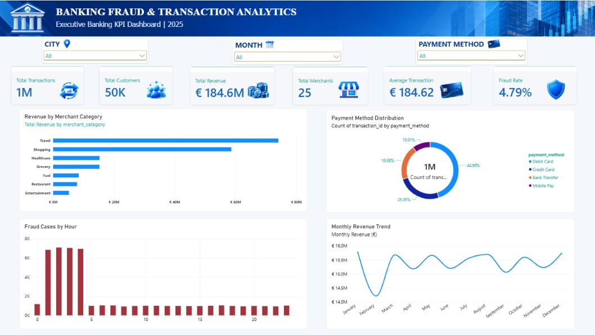

# 🏦 Banking Fraud & Transaction Analytics

An end-to-end banking analytics project that explores transaction performance, revenue distribution, customer activity, payment methods, and potential fraud patterns using **Python, SQL, SQLite, and Power BI**.

The project transforms transaction data into business insights through data preparation, SQL-based analysis, KPI development, and an interactive Power BI dashboard.

## 📊 Dashboard Preview



## 🎯 Business Objectives

- Monitor transaction volume and revenue performance.
- Analyze revenue across merchant categories.
- Understand payment method distribution.
- Examine fraud patterns across transaction hours and payment methods.
- Build a consolidated dashboard to support data-driven decisions.

## 🛠️ Tools & Technologies

| Tool | Purpose |
|---|---|
| Python | Data preparation and database import |
| Pandas | Data handling and processing |
| SQL | Business queries, aggregations, and analysis |
| SQLite | Relational database storage and querying |
| Power BI | Interactive dashboard and KPI visualization |
| Jupyter Notebook | Dataset generation and exploration |
| Git & GitHub | Version control and project documentation |

## 📈 Key Performance Indicators

| KPI | Reported Value |
|---|---:|
| Total Transactions | 1,000,000 |
| Total Customers | Approximately 50,000 |
| Total Revenue | €184.6M |
| Total Merchants | 25 |
| Average Transaction Value | €184.62 |
| Fraud Rate | 4.79% |

*These figures represent the project's current analysis. Revenue and fraud metrics should be interpreted in the context of the dataset and its underlying assumptions.*

## 🔍 Key Analytical Findings

- **Revenue concentration:** Travel and Shopping are the leading merchant categories by revenue in the current analysis.
- **Payment methods:** Mobile Pay has a reported fraud rate of 8.65%, higher than the reported rates for Credit Card and Bank Transfer.
- **Fraud monitoring:** Hourly analysis helps investigate when flagged transactions occur.
- **Revenue trends:** Monthly revenue visualization supports comparisons across reporting periods.
- **Interactive exploration:** City, month, and payment method filters allow users to examine different segments.

These findings describe patterns in the analyzed dataset; they do not establish the causes of fraud or prove that the same patterns occur in real banking operations.

## 📊 Power BI Dashboard Features

The dashboard includes:

- KPI cards for transactions, customers, revenue, merchants, average transaction value, and fraud rate.
- Revenue by merchant category.
- Payment method distribution.
- Fraud cases by hour.
- Monthly revenue trend.
- Slicers for city, month, and payment method.

## 🗄️ SQL Analysis

The SQL scripts organize the database setup, data import workflow, and business analysis.

Example business questions include:

- What is the total transaction volume and revenue?
- Which merchant categories generate the most revenue?
- How does revenue vary by city?
- Which payment methods have higher observed fraud rates?
- How are flagged transactions distributed across hours?

See the [`sql/`](sql/) directory for the schema and analytical queries.

## 📁 Project Structure

```text
banking-fraud-analytics/
├── dashboard/
│   └── Banking.pbix
├── data/
│   └── raw/
│       ├── customers.csv
│       └── merchants.csv
├── images/
│   └── Dashboard.jpg
├── notebooks/
│   └── 01-generate-banking-dataset.ipynb
├── sql/
│   ├── 01_schema.sql
│   ├── 02_data_import.sql
│   └── 03_business_queries.sql
├── import_to_sqlite.py
├── requirements.txt
├── .gitignore
└── README.md
```

The large transaction CSV and local SQLite database are excluded from version control. The transaction data may need to be generated or obtained through the project's data workflow before reproducing the complete analysis.

## 🚀 Getting Started

### 1. Clone the repository

```bash
git clone https://github.com/PRAJWAL2866/banking-fraud-analytics.git
cd banking-fraud-analytics
```

### 2. Create a Python environment

```bash
python -m venv .venv
```

Activate it on Windows PowerShell:

```powershell
.\.venv\Scripts\Activate.ps1
```

### 3. Install dependencies

```bash
pip install -r requirements.txt
```

### 4. Prepare the data

Open the notebook in `notebooks/` and review the dataset-generation workflow. Ensure the required CSV files exist at the paths expected by the notebook and Python scripts.

### 5. Run the database workflow

Review the scripts in `sql/` in sequence, starting with the schema and then the data import and business queries. Check the expected file paths and database configuration before executing them.

Run the Python import script when the required input files and database settings are ready:

```bash
python import_to_sqlite.py
```

### 6. Explore the dashboard

Open `dashboard/Banking.pbix` using Microsoft Power BI Desktop. If the original data files are not available, update the data source paths and refresh the model before using the report.

## ⚠️ Data & Reproducibility Notes

- The repository does not include the large transaction CSV or the local SQLite database.
- Reproducing the full analysis requires the transaction data and any other inputs referenced by the scripts.
- Confirm the dataset-generation process and fraud-label definitions before interpreting results.
- Reported fraud rates are descriptive metrics, not a validated fraud-detection model or a measure of model accuracy.

## 💡 Skills Demonstrated

**Data Analytics · Data Cleaning · Python · Pandas · SQL · SQLite · KPI Design · Power BI · Dashboard Development · Business Intelligence · Data Storytelling · Git**

## 👤 Author

**Prajwal Phalke**

MSc Data Science | Data Analytics & Business Intelligence

GitHub: [PRAJWAL2866](https://github.com/PRAJWAL2866)

---

*Built as a portfolio project to demonstrate an end-to-end analytics workflow, from data preparation and SQL analysis to interactive business reporting.*
